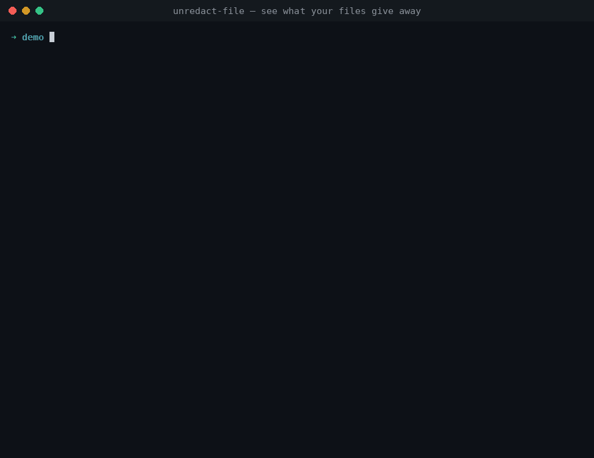
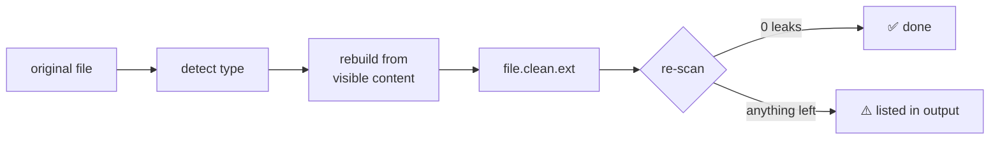

<div align="center">

# 🕵️ unredact-file

### See what your files give away before someone else does. Then scrub it.

[](https://github.com/NPCmillionaire/unredact.tools/actions/workflows/tests.yml)


[**Install**](#-install) · [**Usage**](#-usage) · [**What it detects**](#-what-it-detects) · [**How sanitizing works**](#-how-sanitizing-works) · [**Roadmap**](#-roadmap)

<sub>Part of the <a href="https://unredact.tools"><b>unredact.tools</b></a> privacy suite</sub>

<br>



</div>

<br>

Every photo, PDF, and Office document carries more than what's on screen: **GPS coordinates, camera serial numbers, usernames, earlier drafts, deleted text, comments,** and **invisible watermarks** that identify exactly whose copy leaked.

`unredact-file` answers one question: ***if I send this, what does the person receiving it learn about me?*** Then it gives you a copy that answers *"nothing."*

<table>
<tr>
<td width="50%" valign="top">

### 🔍 `scan`
Shows **what's leaking** and translates it into a plain-English summary: **WHERE · WHO · DEVICE · WHEN · SOFTWARE · ORG · HIDDEN · TRACKING**.

```console
$ unredact-file scan vacation.jpg
  2 critical  7 high  8 medium  3 low
  WHERE   GPS 41.0975, -80.6534 → maps link
  DEVICE  iPhone 15 Pro · serial F2LXK9ABC123
  HIDDEN  thumbnail of the uncropped original
```

</td>
<td width="50%" valign="top">

### 🧽 `sanitize`
Rebuilds a **clean copy** from visible content only, then **re-scans it to prove** nothing survived.

```console
$ unredact-file sanitize memo.docx
+ memo.docx -> memo.clean.docx
  leaks: 39 before -> 0 after
```

</td>
</tr>
</table>

---

## 📜 Why this exists

People have been caught by metadata for as long as files have carried it.

| Year | Incident | What leaked |
|:---:|---|---|
| **2012** | John McAfee is located while hiding from authorities | GPS EXIF data in a photo a journalist posted |
| **2017** | The source of a leaked NSA document is identified | **Printer tracking dots** on the scan identified the printer and the time it was printed |
| **2019** | Paul Manafort's lawyers file a "redacted" PDF | Black boxes drawn **over** text that was still there; reporters copied it out within minutes |
| **Always** | Everyday Office and PDF files | Tracked changes, comments, author usernames, and every incrementally saved earlier version |

Good tools exist (ExifTool, mat2, Dangerzone), but each one does a single job, and none of them **explains the risk**. `unredact-file` combines detection, explanation, and sanitizing in one command.

---

## 📦 Install

```bash
git clone https://github.com/NPCmillionaire/unredact.tools
cd unredact.tools
pip install -e .
```

<details>
<summary><b>Optional extras</b></summary>

| Extra | Command | Adds |
|---|---|---|
| HEIC / HEIF | `pip install -e ".[heic]"` | iPhone photos |
| Audio / video | `brew install ffmpeg` · `apt install ffmpeg` | MP4, MOV, MKV, MP3, FLAC… |
| Dev / tests | `pip install -e ".[dev]"` | pytest + leaky-fixture generators |

</details>

---

## 🚀 Usage

### Scan

```bash
unredact-file scan photo.jpg                     # human-readable report
unredact-file scan *.pdf *.docx                  # many files at once
unredact-file scan memo.docx --extract ./loot    # save recovered artifacts
unredact-file scan filing.pdf --json             # machine-readable
unredact-file scan photo.jpg --all               # include info-level findings
```

`--extract` writes out everything the scan recovered (embedded thumbnails, earlier PDF revisions, attachments, motion-photo video, embedded documents) to `./loot/<file>_artifacts/`.

### Sanitize

```bash
unredact-file sanitize photo.jpg                   # → photo.clean.jpg
unredact-file sanitize a.pdf b.docx c.mp4          # batch
unredact-file sanitize report.pdf -o public.pdf    # custom output path
unredact-file sanitize report.pdf --pdf-mode text  # keep selectable text
```

> [!NOTE]
> The original file is **never modified**. Every output is re-scanned automatically, and anything that survived is listed.

### Help & OPSEC tips

```bash
unredact-file --help        # banner, commands, examples, plus a rotating OPSEC tip
unredact-file tip           # one random tip
unredact-file tip --all     # all 40
```

Colors follow your terminal: they're off automatically when piped, and `NO_COLOR` / `--no-color` are respected.

### Use it as a CI gate

The exit code is `0` when nothing high or critical is found and `2` when something is, so you can block a release that would publish leaky files:

```yaml
- run: pip install git+https://github.com/NPCmillionaire/unredact.tools
- run: unredact-file scan public/**/*.{pdf,jpg,png,docx} --no-color
```

---

## 🧠 What it detects

Findings are graded by severity and rolled up into the **"what this file gives away"** summary.

| Severity | Meaning |
|---|---|
| 🟥 **critical** | Pinpoints you or exposes content you meant to remove (exact GPS, text under a redaction box, deleted text) |
| 🟧 **high** | Identifies you, your device, or your org (names, serials, usernames, hidden sheets) |
| 🟨 **medium** | Narrows things down (timezone, device model, edit history) |
| 🟦 **low** | Fingerprints or context (software versions, timestamps, IDs) |

Detection is organized into four layers:

| Layer | Focus | Status |
|---|---|:---:|
| **1 · Hard metadata** | Fields stored alongside the content | ✅ shipped |
| **2 · Broken redactions & hidden content** | Content the author believes is gone or invisible | ✅ shipped · 🗺️ OCR/blur next |
| **3 · Visual content OSINT** | What the pixels themselves reveal | 🗺️ planned |
| **4 · Fingerprinting & tracking** | Marks that tie a file to a person, device, or copy | ✅ text · 🗺️ printer dots, PRNU |

<sub>✅ shipped &nbsp;·&nbsp; 🚧 partial &nbsp;·&nbsp; 🗺️ planned</sub>

<details open>
<summary><h3>Layer 1 · Hard metadata</h3></summary>

*Deterministic fields that sit next to the content. These are the easiest to check and the most often forgotten.*

| | Leak | Where it hides |
|:-:|---|---|
| ✅ | **GPS coordinates** (with map link), altitude, compass heading, speed | EXIF GPS IFD · XMP · video `©xyz` / ISO 6709 |
| ✅ | **Timestamps + timezone offset** | EXIF `DateTimeOriginal`/`OffsetTime` · PDF Info · `core.xml` · zip entry times |
| ✅ | **Device make, model, body + lens serial numbers** | EXIF · XMP `aux:SerialNumber` · `com.apple.quicktime.*` |
| ✅ | **Owner, author, artist, last-modified-by, manager, company** | EXIF · IPTC · XMP `dc:creator` · PDF Info · Office props |
| ✅ | **Software versions and edit history** | EXIF `Software` · XMP `xmpMM:History` · PDF `Producer` · Office `AppVersion` |
| ✅ | **Usernames in file paths** (`C:\Users\jsmith\…`, `/Users/cam/…`) | PDF titles · JPEG comments · Excel `absPath` · Word templates |
| ✅ | **Internal infrastructure**: UNC shares, SharePoint URLs, private IPs | Office `.rels` · data connections · metadata strings |
| ✅ | **Microsoft 365 tenant ID** | Sensitivity-label props (`MSIP_Label_*_SiteId`) |
| ✅ | **Editing time, revision count, last printed** | `docProps/app.xml` · `docProps/core.xml` |
| ✅ | **Vendor MakerNote blobs** (shutter count, internal IDs) | EXIF `MakerNote` |
| ✅ | **Document IDs** that link copies and versions | XMP `DocumentID` · PDF trailer `/ID` |
| ✅ | **AI-generation prompts and settings** | PNG `parameters` chunk (Stable Diffusion, ComfyUI) |

</details>

<details open>
<summary><h3>Layer 2 · Broken redactions & hidden content</h3></summary>

*Content the author believes is gone or invisible but isn't. This layer gives the project its name.*

| | Leak | How it's found |
|:-:|---|---|
| ✅ | **Failed PDF redactions**: text still under black boxes, black images, or unapplied redaction annotations | Finds dark shapes and images, then extracts the words beneath |
| ✅ | **Earlier PDF versions**, with a diff of the **text deleted since** | Splits at each `%%EOF` and re-parses every revision |
| ✅ | **Tracked deleted text** in Word, plus change authors | Walks `w:del` / `w:moveFrom` |
| ✅ | **Comments**, commenters, collaborator IDs and emails | `comments*.xml` · `people.xml` · `xl/persons` |
| ✅ | **Hidden text**: `w:vanish`, white-on-white, microscopic, transparent, off-page | Run properties · span color/size/alpha |
| ✅ | **Hidden sheets**, rows, and columns; pivot caches holding deleted data | `workbook.xml` · sheet XML · `pivotCache` |
| ✅ | **Speaker notes and hidden slides** | `ppt/notesSlides` · `show="0"` |
| ✅ | **EXIF thumbnail of the original, uncropped photo** | Thumbnail vs. image aspect-ratio check |
| ✅ | **Motion-photo video** and other data appended after the image ends | Walks JPEG markers to the true end-of-image |
| ✅ | **Attachments and embedded objects**, scanned recursively | `EmbeddedFiles` · `word/embeddings/` |
| ✅ | **Hidden PDF layers**, **extra image frames** (depth/gain maps) | OCG state · MPO frames |
| ✅ | **Metadata inside embedded images** (a JPEG in a PDF keeps its GPS) | Every embedded image is scanned as its own file |
| 🗺️ | **Reversible pixelation/blur** | Depix-style block analysis |
| 🗺️ | **Readable text in screenshots** (tabs, notifications, URLs) | OCR |

</details>

<details>
<summary><h3>Layer 3 · Visual content OSINT <sup>planned</sup></h3></summary>

*What a human analyst, or a vision model, can work out from the pixels themselves. Stripping metadata doesn't touch this.*

| | Leak |
|:-:|---|
| 🗺️ | **Reflections** in glasses, windows, screens, and chrome |
| 🗺️ | **Readable text in the scene**: street signs, mail labels, badges, license plates, whiteboards, monitors |
| 🗺️ | **Geolocation clues**: architecture, vegetation, outlets, road markings, plus **sun angle combined with the timestamp** |
| 🗺️ | **Bystanders and children**: face detection with one-click blur |
| 🗺️ | **QR codes and barcodes**, especially boarding passes (name, PNR, frequent-flyer number) |
| 🗺️ | **Cross-file correlation** through [unredact.me](https://unredact.me): *"this camera serial also appears in 3 photos on your public Flickr"* |

</details>

<details open>
<summary><h3>Layer 4 · Fingerprinting & tracking</h3></summary>

*Marks that tie a file to a specific person, device, or copy, often added deliberately to catch leakers.*

| | Leak | Notes |
|:-:|---|---|
| ✅ | **Zero-width character watermarks** (canary traps) | `U+200B`–`U+200F`, `U+2060`–`U+2064`, `U+FEFF` |
| ✅ | **Unicode tag smuggling**: invisible text, **decoded and shown** | Also used for prompt-injection payloads |
| ✅ | **Homoglyph substitution**: Cyrillic/Greek look-alikes swapped into Latin words | Mixed-script word detection |
| ✅ | **Odd-width space patterns** | Weak signal, flagged as low |
| ✅ | **Word rsid session IDs** that link drafts | `w:rsid*` attributes |
| ✅ | **Phone-home objects**: JavaScript, Launch, SubmitForm, remote references | PDF object scan |
| ✅ | **Persistent document IDs** | PDF `/ID` · XMP instance IDs |
| 🗺️ | **Printer tracking dots** (Machine Identification Code) | Yellow-channel isolation + grid decoding |
| 🗺️ | **Camera sensor noise (PRNU)** linking photos to one camera | Survives re-encoding |

</details>

---

## 🧽 How sanitizing works

> [!IMPORTANT]
> Sanitizing means **rebuilding the file from its visible content**, not deleting known-bad fields one by one. A rebuild never copies a field the tool doesn't know about.



| Format | What happens |
|---|---|
| **🖼️ Images** | Bakes EXIF rotation into the pixels and converts the ICC profile to sRGB, then copies **raw pixels only** into a new image and re-encodes it. EXIF, GPS, XMP, IPTC, thumbnails, MakerNotes, comments, text chunks, appended video, and extra frames are all gone. |
| **📄 PDF · `raster`** *(default)* | Every page is rendered to an image and rebuilt into a new PDF (the Dangerzone approach). **Nothing survives except pixels.** |
| **📄 PDF · `text`** | Burns in **real** redactions under every detected black box, removes hidden text, annotations, JavaScript, attachments, thumbnails and metadata, strips EXIF from embedded JPEGs, rewrites the whole file (old revisions gone), and assigns a fresh random `/ID`. |
| **📝 Office** | Empties properties, **accepts all tracked changes**, deletes comments, people and speaker notes, removes hidden text and rsids, nulls template and data-source paths, **unhides** hidden sheets, rows and slides (so you see what you're sending), sanitizes embedded media, and zeroes zip timestamps. |
| **🎬 Audio / video** | `ffmpeg -c copy` (no quality loss). Keeps only video, audio, and subtitle streams, which **drops timed GPS and gyro tracks**. Wipes all metadata and sets bitexact flags. |
| **🔤 Text** | Removes zero-width and tag characters, normalizes odd spaces, and fixes homoglyphs, but only inside mixed-script words, so real Cyrillic or Greek text is left alone. |

> [!TIP]
> Use **`raster`** when the stakes are real. Use **`text`** when you need the PDF to stay searchable (court filings, published reports).

---

## 🗂️ Supported formats

| Type | Scan | Sanitize | Needs |
|---|:-:|:-:|---|
| JPEG · PNG · WebP · TIFF · GIF · BMP | ✅ | ✅ | |
| HEIC · HEIF · AVIF | ✅ | ✅ → JPEG | `pillow-heif` |
| PDF | ✅ | ✅ | |
| DOCX · XLSX · PPTX (+ macro variants) | ✅ | ✅ | |
| MP4 · MOV · M4A · MKV · WebM · MP3 · FLAC · WAV | ✅ | ✅ | `ffmpeg` |
| Plain text (txt · md · csv · json…) | ✅ | ✅ | |
| ZIP | ✅ names + comment | ❌ | |
| ODT · ODS · camera RAW | 🗺️ | 🗺️ | |

---

## 🏗️ Architecture

<details>
<summary><b>Module layout</b></summary>

```
unredact_file/
├── cli.py        scan / sanitize commands, report rendering, exit codes
├── scanner.py    magic-byte type detection → dispatch
├── model.py      Report · Finding · Artifact · "facts" for the summary
├── common.py     username/host/email/IP detectors · canary-trap text analysis
├── xmp.py        generic XMP packet walker
├── image.py      EXIF/GPS/IPTC/XMP/thumbnail/trailer analysis + pixel-rebuild sanitizer
├── pdf.py        redaction checks, revisions, hidden text, JS · raster/text sanitize
├── office.py     OOXML part-level analysis + package rewriter
└── media.py      ffprobe / ffmpeg wrapper
```

</details>

**Design principles**

- 🔒 **Local-first.** Nothing leaves your machine. A privacy tool that makes you upload the file defeats its own purpose.
- 💬 **Explain, don't just list.** Every finding is translated into what an adversary learns from it.
- 🧱 **Rebuild, don't patch.** Sanitizers build new files from visible content.
- ✅ **Prove it.** Every sanitize re-runs the scanner on its own output.
- 🪆 **Recursive.** An image inside a Word document inside a PDF attachment gets the same scrutiny as a standalone file.

---

## ⚠️ Limitations

> [!WARNING]
> **Layer 3 isn't built yet.** A photo with no metadata can still show your street sign, your face in a reflection, or your boarding pass.

- **PRNU sensor noise survives re-encoding.** A clean photo can still be statistically linked to the camera that took it.
- **Raster PDF mode loses text selection and accessibility.** Use `--pdf-mode text` if you need them.
- **Excel sanitize removes comment VML**, which also removes legacy form controls.
- **Encrypted PDFs** are reported but not analyzed.
- **Detection is heuristic.** An unusual redaction (a dark pattern fill, a clipping-path trick) could be missed.

---

## 🗺️ Roadmap

- [x] Layer 1: hard metadata across images, PDF, Office, and media
- [x] Layer 2: failed redactions, revisions, tracked changes, hidden content
- [x] Layer 4: text canaries, rsids, phone-home objects
- [x] Self-verifying `sanitize`
- [ ] Layer 2: reversible blur detection · screenshot OCR
- [ ] Layer 3: vision-model scene analysis · faces, plates, QR codes · sun-angle geolocation
- [ ] Layer 4: printer tracking dots · PRNU linkage
- [ ] `--blur-faces` and `--redact-regions` for visual sanitizing
- [ ] ODF and camera RAW support
- [ ] Browser/WASM version on unredact.tools (files never leave the device)
- [ ] unredact.me integration to cross-reference serials, usernames, and document IDs
- [ ] Batch API for newsrooms and law firms

---

## 🧪 Development

```bash
pip install -e ".[dev]"
pytest -q
```

`tests/make_fixtures.py` generates **deliberately leaky** files: a GPS-tagged photo with an uncropped thumbnail and appended video, a court-style PDF with a failed redaction and an earlier revision, a Word memo with deleted tracked changes and canary characters, a spreadsheet with a hidden sheet, a deck with speaker notes, a watermarked text file, and a GPS-tagged MP4. The tests assert that **every fixture leaks before sanitizing and leaks nothing after.**

To see it in action:

```bash
python tests/make_fixtures.py ./demo
unredact-file scan ./demo/* --extract ./demo/loot
```

---

## 📚 Prior art

| Tool | Focus |
|---|---|
| [ExifTool](https://exiftool.org) | The reference metadata reader/writer |
| [mat2](https://0xacab.org/jvoisin/mat2) | Metadata removal, Tails/Tor ecosystem |
| [Dangerzone](https://dangerzone.rocks) | Untrusted documents → safe pixel-only PDFs |
| [Depix](https://github.com/spipm/Depix) | Recovers text from pixelated screenshots (the attack Layer 2 will warn about) |
| [x-ray](https://github.com/freelawproject/x-ray) | Free Law Project's bad-redaction finder for court PDFs |

---

<div align="center">

**[unredact.tools](https://unredact.tools)** · built by [NPCmillionaire](https://github.com/NPCmillionaire) · Cloudsculpting Labs

<sub>Know what you're sharing.</sub>

</div>
